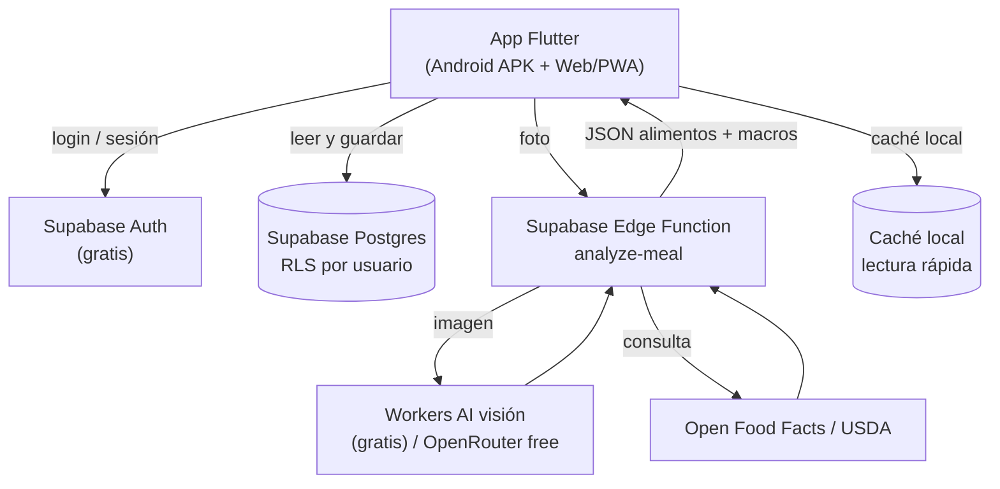

# Especificación de diseño — App de fitness y control de calorías por foto

- **Fecha:** 2026-10-08
- **Estado:** Aprobada (pendiente de plan de implementación)
- **Autor:** diseñada junto al usuario
- **Nombre de la app:** por decidir (no bloquea el diseño ni la implementación)

---

## 1. Resumen y objetivo

Construir una aplicación de fitness para **uso personal** (el usuario y dos amigos) con estas capacidades centrales:

1. **Cuenta y sincronización**: registrarse/iniciar sesión con **email y contraseña**, de forma que el progreso quede ligado a la **cuenta** y sea accesible desde **cualquier dispositivo**.
2. **Diario de comidas por foto**: fotografiar un plato y que la IA estime los alimentos, la porción y los **macros (calorías, proteína, carbohidratos y grasa)**.
3. **Registro de entrenamientos**: registrar sesiones con **series × repeticiones × peso** y métricas avanzadas (volumen, récords personales y gráficas por ejercicio).
4. **Progreso semanal**: un resumen que **compare la semana actual con la anterior** (volumen, sesiones, récords nuevos, medias de macros y adherencia) e indique mejora o retroceso.

**Restricción dura:** todo el sistema debe funcionar con **planes gratuitos**, sin tarjeta de crédito ni costes recurrentes.

**Éxito =** las tres personas pueden iniciar sesión, registrar comidas y entrenamientos desde sus dispositivos (Android e iPhone), cambiar de dispositivo sin perder su progreso y usar la app sin pagar nada.

---

## 2. Personas y contexto

| Persona | Dispositivo | Notas |
| --- | --- | --- |
| Usuario principal | Android | Programador; dirigirá y probará el desarrollo |
| Amigo A | iPhone | Usará la app vía web/PWA |
| Amigo B | iPhone | Usará la app vía web/PWA |

**Implicaciones clave:**
- Como publicar en iOS no es gratis (99 €/año de Apple), los amigos de iPhone usarán la **versión web/PWA** (se abre en Safari → "Añadir a pantalla de inicio"). El usuario principal usa el **APK nativo de Android**.
- Cada persona tiene **su propia cuenta** y ve **solo su progreso**.

---

## 3. Alcance

### 3.1 Incluido en v1

- Autenticación con **email y contraseña**; sesión persistente.
- Perfil con objetivos diarios de calorías y macros y unidades (kg/lb).
- **Sincronización en la nube**: el progreso se guarda en la cuenta y se ve desde cualquier dispositivo.
- **Análisis de comida por foto** con IA, resultado **editable** antes de guardar.
- Añadir comidas manualmente como alternativa.
- Catálogo de ejercicios + ejercicios propios.
- Registro de sesiones con series (reps/peso/RPE opcional).
- Métricas avanzadas: volumen, PRs (peso máximo y 1RM estimado), gráficas por ejercicio.
- Resumen semanal comparando semana actual vs anterior.

### 3.2 Fuera de alcance (para futuras versiones)

- Red social, feed o comparación entre amigos.
- Uso **sin conexión** con cola de sincronización (en v1 se puede consultar la caché local, pero registrar requiere conexión).
- Escaneo de código de barras.
- Registro por voz.
- Integración con Apple Health / Google Fit.
- Generación de planes de dieta o rutinas por IA.
- Publicación en App Store / Google Play.

---

## 4. Requisitos funcionales

### 4.1 Cuenta y sincronización

- **RF-1:** El usuario puede registrarse con email y contraseña.
- **RF-2:** El usuario puede iniciar y cerrar sesión; la sesión persiste entre reinicios.
- **RF-3:** Al registrarse se crea automáticamente un perfil con valores por defecto.
- **RF-4:** Cada usuario solo puede ver y modificar **sus propios** datos.
- **RF-5:** Al iniciar sesión en un dispositivo nuevo, el usuario ve el mismo progreso que en los demás (datos servidos desde la cuenta).
- **RF-6:** El usuario puede editar su perfil (nombre, objetivo diario de calorías y macros, unidades).

### 4.2 Diario de comidas por foto

- **RF-7:** El usuario puede tomar una foto o elegir una de la galería.
- **RF-8:** La app comprime la imagen antes de enviarla (lado mayor ≤ 1024 px, JPEG).
- **RF-9:** El backend identifica los alimentos y estima porciones con un modelo de visión.
- **RF-10:** La app contrasta los valores con una base nutricional gratuita y devuelve kcal/macros por alimento y totales.
- **RF-11:** El resultado se muestra en una pantalla **editable**: añadir/quitar alimentos, ajustar cantidad/unidad y corregir kcal/macros.
- **RF-12:** Al confirmar, la entrada se guarda asociada a una fecha/hora y a un tipo de comida (desayuno/comida/cena/snack).
- **RF-13:** El usuario puede añadir una comida **manualmente** sin IA y editar/eliminar entradas existentes.
- **RF-14:** Cada entrada indica su origen (`ai` o `manual`) y marca los valores estimados que no se pudieron verificar.
- **RF-15:** El usuario puede ver el total diario de kcal/macros y el progreso frente a su objetivo.

### 4.3 Registro de entrenamientos

- **RF-16:** El usuario dispone de un catálogo de ejercicios comunes y puede crear ejercicios propios (nombre, grupo muscular).
- **RF-17:** El usuario puede iniciar una sesión y añadir series (ejercicio, nº de serie, reps, peso, RPE opcional).
- **RF-18:** El usuario puede marcar una serie como completada y finalizar/guardar la sesión.
- **RF-19:** La app calcula el **volumen** de la sesión = Σ(reps × peso).
- **RF-20:** La app detecta **nuevos récords (PR)** por ejercicio (peso máximo y 1RM estimado).
- **RF-21:** La app muestra una **gráfica de evolución** por ejercicio (peso máximo y/o volumen a lo largo del tiempo).

### 4.4 Progreso y resumen semanal

- **RF-22:** La app ofrece un **resumen semanal** que compara la **semana ISO actual** con la **anterior**.
- **RF-23:** El resumen incluye, para cada semana: volumen total, nº de sesiones, PRs nuevos, media diaria de kcal y macros, y adherencia (días con registro).
- **RF-24:** Cada métrica muestra el **delta** respecto a la semana anterior con indicación visual de mejora (↑) o retroceso (↓).
- **RF-25:** El usuario puede navegar a semanas anteriores para revisar su historial.

---

## 5. Arquitectura

### 5.1 Diagrama general

### 5.2 Componentes

- **App Flutter** — UI, cámara, compresión de imagen, caché local, cálculos de progreso y cliente de Supabase. Compila a **Android** y **Web/PWA**.
- **Supabase** — corazón del sistema en el plan gratuito:
  - **Auth**: email y contraseña.
  - **Postgres** con **Row Level Security (RLS)** para aislar los datos por usuario.
  - **Edge Function** `analyze-meal`: único lugar con secretos; llama a la IA y a la base nutricional.
  - **Storage** (opcional): fotos de comidas en bucket privado.
- **Cloudflare Workers AI** — inferencia de visión gratuita (10.000 neuronas/día). Invocado desde la Edge Function.
- **OpenRouter** — modelos `:free` de visión como **respaldo** de la IA.
- **Open Food Facts / USDA FoodData Central** — valores nutricionales reales.

### 5.3 Stack tecnológico

| Capa | Elección | Motivo |
| --- | --- | --- |
| App | Flutter (Dart) | Una base de código para Android y Web |
| Estado | Riverpod | Maduro, testeable, sin dependencias pesadas |
| Navegación | go_router | Navegación declarativa y URLs en web |
| Auth + BD + Storage | Supabase (plan free) | Login + Postgres con RLS + Storage, gratis y sin tarjeta |
| Backend/IA proxy | Supabase Edge Functions | Oculta la clave; 500.000 llamadas/mes gratis |
| IA de visión | Cloudflare Workers AI (free) | 10.000 neuronas/día; cientos de análisis/día |
| IA de respaldo | OpenRouter modelos `:free` | Alternativa si Workers AI falla |
| Base nutricional | Open Food Facts (libre) + USDA FDC | Valores fiables y gratuitos |
| Cámara | `image_picker` (+ compresión) | Funciona en Android y en navegador |
| Caché local | `sembast` | Ligero, sin códigos generados, soporte web |
| HTTP | `http` / `dio` | Cliente con tiempos de espera y reintentos |

### 5.4 Decisión de sincronización

La **fuente de verdad** son las tablas de Supabase, protegidas por RLS y asociadas al `user_id`. La app **lee y escribe** contra Supabase; mantiene una **caché local de solo lectura** para mostrar listas rápido y permitir consultar datos sin conexión. El registro sin conexión con cola de sincronización se pospone a v2.

---

## 6. Modelo de datos

Todas las tablas aplican **RLS**: el `user_id` debe coincidir con `auth.uid()`.

### 6.1 Perfiles

**`profiles`**
| Campo | Tipo | Notas |
| --- | --- | --- |
| `id` | uuid (PK) | = `auth.users.id` |
| `display_name` | text | |
| `daily_calorie_target` | int | |
| `protein_target_g` | numeric | |
| `carbs_target_g` | numeric | |
| `fat_target_g` | numeric | |
| `units` | text | `kg` \| `lb` |
| `created_at` | timestamptz | |

### 6.2 Comidas

**`food_entries`**
| Campo | Tipo | Notas |
| --- | --- | --- |
| `id` | uuid (PK) | |
| `user_id` | uuid | FK a `auth.users` |
| `logged_at` | timestamptz | fecha/hora de la comida |
| `meal_type` | text | `breakfast`\|`lunch`\|`dinner`\|`snack` |
| `total_calories` | int | |
| `total_protein_g` | numeric | |
| `total_carbs_g` | numeric | |
| `total_fat_g` | numeric | |
| `photo_path` | text (null) | ruta en Storage |
| `source` | text | `ai` \| `manual` |
| `created_at` | timestamptz | |

**`food_entry_items`**
| Campo | Tipo | Notas |
| --- | --- | --- |
| `id` | uuid (PK) | |
| `food_entry_id` | uuid | FK `food_entries`, ON DELETE CASCADE |
| `name` | text | |
| `quantity` | numeric | |
| `unit` | text | `g`, `ml`, `unit`… |
| `calories` | int | |
| `protein_g` | numeric | |
| `carbs_g` | numeric | |
| `fat_g` | numeric | |
| `confidence` | numeric (null) | 0–1, procedente de la IA |
| `estimated` | boolean | true si no se pudo verificar en la base nutricional |

### 6.3 Entrenamiento

**`exercises`**
| Campo | Tipo | Notas |
| --- | --- | --- |
| `id` | uuid (PK) | |
| `user_id` | uuid | propietario |
| `name` | text | |
| `muscle_group` | text | |
| `is_custom` | boolean | |
| `created_at` | timestamptz | |

**`workout_sessions`**
| Campo | Tipo | Notas |
| --- | --- | --- |
| `id` | uuid (PK) | |
| `user_id` | uuid | |
| `started_at` | timestamptz | |
| `ended_at` | timestamptz (null) | |
| `notes` | text (null) | |
| `created_at` | timestamptz | |

**`workout_sets`**
| Campo | Tipo | Notas |
| --- | --- | --- |
| `id` | uuid (PK) | |
| `session_id` | uuid | FK `workout_sessions`, ON DELETE CASCADE |
| `exercise_id` | uuid | FK `exercises` |
| `set_index` | int | orden dentro del ejercicio |
| `reps` | int | |
| `weight` | numeric | en unidades del perfil |
| `rpe` | numeric (null) | 1–10 |
| `completed` | boolean | |

### 6.4 Fórmulas derivadas (se calculan, no se almacenan)

- **Volumen de sesión** = Σ(`reps` × `weight`) de sus series.
- **Volumen semanal** = Σ del volumen de las sesiones de la semana ISO.
- **1RM estimado (Epley)** = `weight` × (1 + `reps` / 30).
- **PR por ejercicio** = máximo histórico de `weight` (y mejor 1RM estimado).
- **Adherencia** = días con al menos un registro (una comida **o** un entrenamiento) / días de la semana.
- **Media diaria de kcal/macros** = media calculada **solo sobre los días con registro**, para no diluir el resultado con días sin datos.
- **Deltas semanales** = (semana actual − semana anterior) por cada métrica.

---

## 7. Flujos detallados

### 7.1 Autenticación y sincronización

1. El usuario se registra o inicia sesión con email y contraseña (Supabase Auth).
2. La sesión se almacena en el dispositivo y se refresca automáticamente.
3. Todas las consultas a la base de datos viajan con el token del usuario; RLS garantiza que solo se accede a sus filas.
4. Al abrir la app en cualquier dispositivo con la misma cuenta, se descarga el progreso actual.

### 7.2 Análisis de comida por foto

1. El usuario hace/elegir una foto → la app la **comprime**.
2. La app llama a la Edge Function `analyze-meal` con la imagen (y un texto opcional).
3. La Edge Function llama a **Workers AI** (visión) y obtiene una lista de alimentos y porciones estimadas.
4. Para cada alimento, consulta **Open Food Facts / USDA** para obtener kcal/macros reales.
5. La Edge Function devuelve JSON: alimentos + totales + `confidence` + `estimated`.
6. La app muestra el resultado **editable**. El usuario ajusta y confirma.
7. Se guardan `food_entries` + `food_entry_items` en Supabase. Se recalcula el total del día.

### 7.3 Registro de entrenamiento

1. El usuario abre una sesión y añade series (ejercicio, reps, peso).
2. Al finalizar, se guardan `workout_sessions` + `workout_sets` en Supabase.
3. Se calcula el volumen y se comprueba si hay **nuevo PR** para el ejercicio.
4. Se actualiza la gráfica de evolución del ejercicio.

### 7.4 Resumen semanal

1. Al abrir la pantalla (o al cerrar la semana), se agregan los datos de la **semana ISO actual** y de la **anterior**.
2. Se calculan los deltas por métrica.
3. Se muestra la comparación con flechas ↑/↓ y el valor absoluto y relativo (p. ej. "Volumen: +12 % vs semana pasada").

---

## 8. IA y cuotas gratuitas

### 8.1 Presupuesto de IA

- **Cloudflare Workers AI:** 10.000 neuronas/día (reinicio 00:00 UTC), sin tarjeta. Es el modelo principal.
  - Modelo de visión previsto: `@cf/meta/llama-3.2-11b-vision-instruct` (4.410 neuronas/M tokens de entrada, 61.493/M de salida).
  - Coste estimado por foto (imagen comprimida + respuesta JSON) ≈ **decenas de neuronas** → **cientos de análisis por día**.
- **Consumo previsto:** ~15 fotos/día entre las tres personas → muy por debajo del presupuesto.
- **Respaldo:** modelos `:free` de OpenRouter (20 req/min, **50 req/día** sin compras).

### 8.2 Optimizaciones

- Comprimir la imagen antes de enviarla.
- No volver a llamar a la IA si el usuario solo corrige valores a mano.
- Reutilizar resultados de alimentos ya analizados cuando sea posible.

### 8.3 Límites de Supabase (plan gratis)

- **Auth:** 50.000 usuarios activos/mes (sobradísimo para 3).
- **Base de datos:** 500 MB; **Storage:** 1 GB; **Edge Functions:** 500.000 llamadas/mes.
- El proyecto **se pausa tras 1 semana de inactividad**; se despierta al primer acceso (opcionalmente se mantiene con un ping programado gratuito).

---

## 9. Manejo de errores

| Situación | Comportamiento |
| --- | --- |
| Cuota de IA agotada o modelo falla | Aviso + permitir **añadir comida a mano**; reintento con espera creciente; probar el respaldo (OpenRouter) |
| Alimento sin coincidencia nutricional | Usar la estimación de la IA y marcarla como `estimated` |
| Fallo al subir/guardar | Mensaje claro; reintentar |
| Sin conexión al guardar | Aviso; se puede consultar la caché, pero registrar requiere conexión (cola offline en v2) |
| Sesión caducada | Pedir re-login sin perder datos; refresco automático de token cuando sea posible |
| Credenciales inválidas en login | Mensaje claro sin revelar si el email existe |
| Supabase pausado | Se despierta en el primer acceso; manejar el retardo inicial |
| Imagen inválida o sin alimentos | Mensaje y opción de reintentar o entrar a mano |

---

## 10. Seguridad y privacidad

- **RLS** en todas las tablas: cada usuario solo accede a sus filas (`user_id = auth.uid()`).
- **Secretos** (clave de Workers AI / OpenRouter, clave USDA) solo en la Edge Function; nunca en la app.
- **Storage** privado con rutas por usuario, si se usa.
- La **clave de IA nunca viaja al cliente**.
- La Edge Function valida el **token de sesión** del usuario antes de procesar.
- Las fotos de comida son datos personales; no se comparten entre usuarios.

---

## 11. Estrategia de pruebas

- **Unitarias (prioritarias):** totales de kcal/macros, comparación semanal (deltas), detección de PRs, volumen y 1RM estimado.
- **Widget tests:** flujo de login, registrar comida (análisis simulado), registrar entrenamiento, pantalla de resumen semanal.
- **Integración:** Supabase y respuestas de IA **simuladas** (mocks) para no gastar cuota ni depender de la red; RLS comprobado con dos usuarios de prueba.
- **Manual:** APK en Android + Safari/PWA en iPhone, verificando la sincronización entre dispositivos.

---

## 12. Restricciones y decisiones

- **Todo gratuito:** Supabase free + Cloudflare Workers AI free + bases nutricionales libres. Sin tarjeta.
- **Distribución:** Android por APK; iPhone por web/PWA (evita los 99 €/año de Apple).
- **Cuenta obligatoria:** permite recuperar el progreso en cualquier dispositivo.
- **V1 online-first:** se requiere conexión para escribir; hay caché local de solo lectura.
- **Sin funciones sociales:** cada cuenta es privada.

---

## 13. Orden de implementación sugerido

Para que el proyecto sea abordable, se construye en fases verificables:

1. **Cuenta y sincronización** — proyecto Flutter, Riverpod, go_router, Supabase Auth, pantallas de login/registro y perfil.
2. **Datos y modelo** — tablas en Supabase con RLS, capa de acceso a datos y caché local.
3. **Entrenamientos** — catálogo de ejercicios, registro de sesiones/series y cálculo de volumen/PRs.
4. **Progreso semanal** — agregación por semana ISO, deltas y pantalla de resumen (con tests unitarios).
5. **Comida por foto** — compresión, Edge Function, Workers AI, base nutricional y pantalla editable.
6. **Multiplataforma y pulido** — build Web/PWA para iPhone, build APK para Android, y pruebas de sincronización en dispositivos reales.

---

## 14. Riesgos y trabajo futuro

**Riesgos**
- Precisión de la estimación de porciones por IA (mitigado con edición y base nutricional).
- Los planes gratuitos pueden cambiar de límites con el tiempo.
- Supabase pausa proyectos inactivos ≥ 7 días (mitigado con uso o ping programado).
- Limitaciones de cámara en la web de iOS (calidad y permisos variables).

**Futuro (post-v1)**
- Cola de sincronización offline real.
- Escaneo de código de barras.
- Funciones sociales entre amigos.
- Integración con Apple Health / Google Fit.
- Publicación en tiendas si el proyecto crece.
